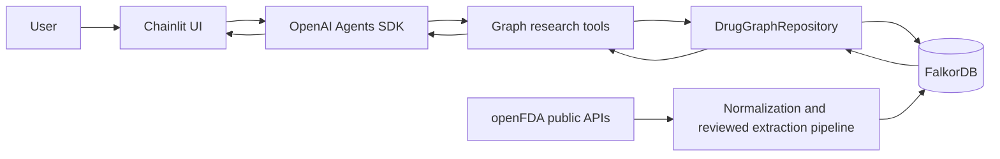
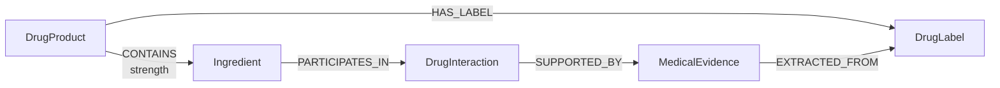

# PharmGraph AI

**Evidence-grounded pharmaceutical research over a FalkorDB knowledge graph.**

PharmGraph AI is an autonomous research agent that explores relationships among drug products, active ingredients, FDA labels, documented interactions, and supporting medical evidence. Instead of answering drug-specific questions from model memory, the agent traverses a FalkorDB graph and presents the graph paths and source provenance behind its conclusions.

> **Medical disclaimer:** PharmGraph AI is a research prototype, not a medical device and not a substitute for a physician or pharmacist. It does not diagnose conditions or recommend starting, stopping, replacing, or changing medication. An absent graph result does not prove that a drug combination is safe.

## Hackathon submission

Built for [Graph Hacks: Context for AI Agents](https://www.wemakedevs.org/hackathons/falkordb), organized by WeMakeDevs and FalkorDB, October 15–18, 2026.

| Item | Details |
| --- | --- |
| Track | **Agents That Act on Connected Data** |
| Source code | [github.com/decembrin/pharmgraph-ai](https://github.com/decembrin/pharmgraph-ai) |
| Demo video | [Watch on YouTube](https://www.youtube.com/watch?v=_k-gre-7VOo) |
| Demo video model | **Qwen/Qwen3.8-27B-FP8** |
| Live deployment | Not currently published; complete local setup is provided below |
| Primary graph database | **FalkorDB** |
| Data | Public openFDA drug NDC and label records; a reproducible seed graph is included |

## The problem

Drug questions are relationship questions. A brand name points to a specific marketed product, that product contains one or more ingredients, an ingredient may participate in a documented interaction, and every interaction claim needs a path back to its source label and the conditions stated there.

A general-purpose chatbot can produce a plausible answer from model memory, but it cannot prove which product record it selected, which graph relationships it traversed, or which source excerpt supports the conclusion. In a medical domain, plausible is not enough.

PharmGraph AI makes that chain explicit:

```text
DrugProduct
  -[:CONTAINS]-> Ingredient
  -[:PARTICIPATES_IN]-> DrugInteraction
  -[:SUPPORTED_BY]-> MedicalEvidence
  -[:EXTRACTED_FROM]-> DrugLabel
```

The model orchestrates the investigation; FalkorDB supplies the facts, relationships, and evidence trail.

## Why FalkorDB is load-bearing

The project is designed around FalkorDB rather than using it only for visualization.

| Product capability | What FalkorDB does | What happens without it |
| --- | --- | --- |
| Resolve a medication | Connects a product NDC to its ingredients and label records | The agent cannot establish product identity or composition |
| Find related products | Traverses `DrugProduct → Ingredient ← DrugProduct` | There is no structural definition of relatedness |
| Investigate interactions | Connects exactly two ingredients through a documented interaction | The agent has no trusted interaction record to retrieve |
| Explain a conclusion | Returns the matched nodes, edges, evidence excerpt, and source label | The answer loses its inspectable evidence chain |
| Enforce cautious absence handling | Distinguishes “no matching evidence in this graph” from “safe” | The model could incorrectly turn missing context into a medical claim |

Removing FalkorDB removes the agent's domain context and its core research capabilities. The graph is the product's evidence and reasoning substrate, not a visualization layered over another database.

## Three-minute judge walkthrough

After starting the stack, use these questions in order:

1. **Resolve a product:** `What active ingredient does Eliquis contain?`
   The agent searches candidate NDC products, selects a graph-backed product, and retrieves its exact `CONTAINS` and `HAS_LABEL` edges.
2. **Traverse connected products:** `Which products share an active ingredient with Advil?`
   The answer comes from the two-hop `DrugProduct → Ingredient ← DrugProduct` pattern rather than semantic similarity.
3. **Demand evidence:** `Is there a documented interaction between Eliquis and aspirin? Show the evidence and graph path.`
   The agent resolves both products to ingredients and follows the interaction to supporting evidence and its source FDA label.

During each step, Chainlit exposes the graph tools being called. The final answer must preserve source conditions and limitations; an empty result is reported as “not established by the available evidence,” never as proof of safety.

The demo video was recorded with **Qwen/Qwen3.8-27B-FP8** as the tool-calling language model. The application is provider-independent and can use another Chat Completions-compatible model through the environment configuration.

## What it does

- Searches drug products by brand or generic name and optional dosage form.
- Resolves a selected NDC product to its active ingredients and FDA label records.
- Finds other products connected through shared active ingredients.
- Investigates documented ingredient-level interactions.
- Returns supporting evidence excerpts together with FDA-label provenance.
- Shows live tool activity in the Chainlit interface so an investigation is traceable.
- Keeps graph findings, source-supported claims, schema possibilities, and unknowns separate.
- Applies medical-safety guardrails and explicitly reports missing or incomplete evidence.

Example questions:

```text
What active ingredient does Eliquis contain?
Which products share an active ingredient with Advil?
Is there a documented interaction between Eliquis and aspirin?
What evidence and graph path support that interaction?
```

The bundled seed is intentionally scoped for the demo and includes records related to Eliquis/apixaban, aspirin, ketoconazole, rifampin, Advil, Motrin IB, PediaCare, Claritin, and Tylenol. It is not a comprehensive drug database.

## What is verified

The following figures were read from the bundled FalkorDB seed and the test suite on October 18, 2026; they are not estimates.

| Seed graph | Count |
| --- | ---: |
| `DrugProduct` nodes | 181 |
| `Ingredient` nodes | 8 |
| `DrugLabel` nodes | 447 |
| `DrugInteraction` nodes | 3 |
| `MedicalEvidence` nodes | 5 |
| Total relationships | 324 |

```text
31 tests passed in the development container
```

The counts describe demo coverage, not clinical completeness. The tests verify graph queries and writes, normalization, evidence extraction safeguards, and UI tool presentation; they do not validate medical suitability or generalize accuracy beyond the included data.

## What is real today

| Component | Status |
| --- | --- |
| FalkorDB-backed runtime queries | Real; every agent tool reads the graph |
| Product, ingredient, label, interaction, and evidence graph | Real; a reproducible seed snapshot is included |
| Source provenance | Real; evidence retains label identifiers, URL, version, section, conditions, and retrieval time |
| Autonomous tool selection | Real; a tool-capable model chooses among four bounded application tools |
| Graph visualization | FalkorDB Browser is available locally; Chainlit shows tool execution rather than a custom graph canvas |
| Medical coverage | Limited demonstration subset; not comprehensive and not for clinical decisions |
| Demo video | Published on [YouTube](https://www.youtube.com/watch?v=_k-gre-7VOo) |

## How the agent works



At runtime, the agent is required to call one or more graph tools before answering:

| Tool | Purpose |
| --- | --- |
| `search_drugs` | Find candidate NDC drug products and resolve graph keys |
| `get_drug_profile` | Retrieve a product, its ingredients, labels, and exact graph edges |
| `find_related_drugs` | Traverse products connected through a shared ingredient |
| `find_documented_interactions` | Retrieve an interaction, evidence, provenance, and the supporting subgraph |

The language model selects tools and explains their results. FalkorDB remains the source of truth for drug entities, relationships, and evidence available to the running application.

## Graph data model



### Nodes

| Label | Key properties | Meaning |
| --- | --- | --- |
| `DrugProduct` | `key` (NDC), `name`, `generic_name`, `labeler_name`, `dosage_form`, `spl_id` | A specific marketed product identified by NDC |
| `Ingredient` | `key`, `name` | A normalized active ingredient |
| `DrugLabel` | `key`, `set_id`, `version`, `source_url` | An openFDA drug-label record and its provenance |
| `DrugInteraction` | `key`, `effect` | A documented interaction between two ingredients |
| `MedicalEvidence` | `key`, `source`, `source_record_id`, `source_url`, `section`, `text`, `evidence_type`, `retrieved_at`, `conditions` | A source excerpt supporting an interaction, including its conditions and provenance |

### Relationships

| Pattern | Meaning |
| --- | --- |
| `(DrugProduct)-[:CONTAINS {strength}]->(Ingredient)` | Product composition |
| `(DrugProduct)-[:HAS_LABEL]->(DrugLabel)` | Product-to-label association |
| `(Ingredient)-[:PARTICIPATES_IN]->(DrugInteraction)` | Ingredient participates in the interaction |
| `(DrugInteraction)-[:SUPPORTED_BY]->(MedicalEvidence)` | Evidence supports the documented interaction |
| `(MedicalEvidence)-[:EXTRACTED_FROM]->(DrugLabel)` | Evidence provenance points to its source label |

This distinction is deliberate: a product is not the same entity as its ingredient, a shared ingredient does not establish therapeutic equivalence, and graph connectivity alone is not medical evidence.

## Cypher queries the product depends on

The complete parameterized query set is in [`src/pharmgraph_ai/graph/queries.py`](src/pharmgraph_ai/graph/queries.py). The central runtime traversals are shown below.

### Search products

```cypher
MATCH (p:DrugProduct)
WHERE (
    toLower(p.name) CONTAINS toLower($name)
    OR toLower(p.generic_name) CONTAINS toLower($name)
)
AND (
    $dosage_form IS NULL
    OR toLower(p.dosage_form) CONTAINS toLower($dosage_form)
)
OPTIONAL MATCH (p)-[:HAS_LABEL]->(l:DrugLabel)
WITH p, exists(l) AS has_label
ORDER BY has_label DESC, p.name, p.key
LIMIT $limit
OPTIONAL MATCH (p)-[r:CONTAINS]->(i:Ingredient)
RETURN p, collect({ingredient: i, strength: r.strength}) AS composition, has_label
```

### Retrieve a product profile and provenance

```cypher
MATCH (p:DrugProduct {key: $product_key})
OPTIONAL MATCH (p)-[contains:CONTAINS]->(i:Ingredient)
OPTIONAL MATCH (p)-[has_label:HAS_LABEL]->(l:DrugLabel)
RETURN p, contains, i, has_label, l
ORDER BY i.key, l.key
```

### Find products with a shared ingredient

```cypher
MATCH (source:DrugProduct {key: $product_key})
      -[source_edge:CONTAINS]->
      (ingredient:Ingredient)
      <-[related_edge:CONTAINS]-
      (related:DrugProduct)
WHERE source <> related
RETURN source, source_edge, ingredient, related_edge, related
ORDER BY related.key, ingredient.key
LIMIT $limit
```

### Find a documented interaction and its evidence

```cypher
MATCH (a:Ingredient {key: $ingredient_a_key})
MATCH (b:Ingredient {key: $ingredient_b_key})
MATCH (a)-[ra:PARTICIPATES_IN]->(interaction:DrugInteraction)
      <-[rb:PARTICIPATES_IN]-(b)
MATCH (interaction)-[re:SUPPORTED_BY]->(e:MedicalEvidence)
MATCH (e)-[rl:EXTRACTED_FROM]->(label:DrugLabel)
RETURN a, ra, b, rb, interaction, re, e, rl, label
ORDER BY interaction.key, e.key
LIMIT $limit
```

In application code, the queries return explicit node IDs, relationship IDs, types, and properties so the UI and agent can report the exact matched subgraph rather than reconstructing a hypothetical path.

## Tech stack

- Python 3.12
- FalkorDB 4.14.9 and the FalkorDB Python client
- OpenAI Agents SDK with an OpenAI-compatible chat-completions endpoint
- Chainlit 2.12
- openFDA public APIs
- Docker Compose
- `uv` for deterministic Python dependency management
- `pytest` and `pytest-asyncio`

## Run locally

### Prerequisites

- Docker with Docker Compose
- An API key for an OpenAI-compatible model provider

### 1. Clone and configure

```bash
git clone https://github.com/decembrin/pharmgraph-ai.git
cd pharmgraph-ai
cp .env.example .env
```

Edit `.env`:

```dotenv
OPENAI_API_KEY=replace-with-your-api-key
OPENAI_BASE_URL=https://api.openai.com/v1
OPENAI_MODEL=gpt-6-astra
OPENAI_TIMEOUT=120
```

`OPENAI_BASE_URL` and `OPENAI_MODEL` may point to another Chat Completions-compatible provider. The selected model must support tool calling.

### 2. Start the application

```bash
docker compose up --build
```

The first build installs the locked dependencies and can take a few minutes.

> **The demo data is ready immediately after startup.** The FalkorDB image automatically restores the bundled graph from `data/falkordb-seed/dump.rdb`, so there is no need to run an import, seed, or ingestion command. Once the services are healthy, open the application and start asking questions.

Open:

- PharmGraph AI: [http://localhost:8000](http://localhost:8000)
- FalkorDB browser: [http://localhost:3000](http://localhost:3000)

The database and web app bind to `127.0.0.1`, so they are not exposed to the network by default.

To stop the stack:

```bash
docker compose down
```

## Tests

All tests must run inside the development container:

```bash
docker compose run --rm dev pytest -q
```

The test suite covers normalization, Cypher query behavior, graph writes, interaction-evidence extraction, and tool-call presentation.

## Rebuild or extend the graph

The checked-in seed makes the demo reproducible. To fetch the configured public NDC and label records from openFDA and merge them into a running graph:

```bash
docker compose run --rm dev python /workspace/scripts/load_graph.py
```

Interaction ingestion uses a deliberately review-first workflow:

```bash
# Dry run: fetch the source label and print extraction candidates
docker compose run --rm dev python /workspace/scripts/extract_interaction.py

# Persist only after a human has reviewed the evidence and conditions
docker compose run --rm dev python /workspace/scripts/extract_interaction.py --apply
```

The extraction pipeline requires exact source quotations, verifies that every quotation occurs in the original FDA label section, preserves provenance and conditions, and does not write anything during a dry run. Automated checks do not replace human medical review.

## Data provenance and permitted use

- Drug product and label data come from the public [openFDA APIs](https://open.fda.gov/apis/).
- The bundled graph contains public data and derived normalized entities; it does not require private, paywalled, login-protected, or personal data.
- Each evidence node stores the source record ID, source URL, label key/set/version, section, retrieval time, conditions, and the supporting excerpt.
- Source documents can change. This prototype does not claim that its dataset is complete or current for clinical use.

## AI-use disclosure

AI tools were used during development, as permitted by the hackathon rules:

- **OpenAI Codex** was used as a coding assistant for implementation, refactoring, code review, test execution, and documentation. All generated changes were reviewed and verified by the participant.
- A configured language model plans runtime graph investigations and turns retrieved results into a user-facing explanation.
- The optional ingestion workflow uses a language model to propose interaction-evidence candidates from public FDA label text.

Participant review remains essential. Runtime medical claims must be grounded in records retrieved from FalkorDB, and ingestion candidates are validated against verbatim source text and are only persisted through an explicit, human-reviewed `--apply` step.

## Repository structure

```text
.
├── data/falkordb-seed/        # Reproducible FalkorDB demo snapshot
├── docker/                    # App and FalkorDB images
├── scripts/
│   ├── load_graph.py          # openFDA product/label ingestion
│   └── extract_interaction.py # Review-first interaction extraction
├── src/
│   ├── app.py                 # Chainlit application entry point
│   └── pharmgraph_ai/
│       ├── agent/             # Agent, tools, context, safety instructions
│       ├── domain/            # Domain entities
│       ├── graph/             # Cypher, repository, graph result models
│       ├── ingestion/         # openFDA client and normalization/extraction
│       ├── tests/             # Automated tests and fixtures
│       └── ui/                # Live tool-call presentation
├── docker-compose.yaml
├── pyproject.toml
└── uv.lock
```

## Current limitations

- The bundled dataset covers a small demonstration subset and is not exhaustive.
- Interaction findings are ingredient-level and do not automatically apply to every formulation, dose, route, or patient.
- Shared ingredients do not imply bioequivalence, interchangeability, or a treatment alternative.
- The agent cannot prove the absence of an interaction from an empty result.
- The application requires an external tool-capable language model endpoint.
- This hackathon prototype has not been validated for clinical decision-making.

## Hackathon compliance checklist

- [x] Public source-code repository
- [x] FalkorDB is the primary graph database and powers central product behavior
- [x] README includes complete local setup instructions
- [x] Graph data model is documented
- [x] Core Cypher queries and graph traversals are documented
- [x] Public-data provenance is documented
- [x] Entered track is named
- [x] AI-assistant use is disclosed
- [x] Local demo path is reproducible from the bundled graph seed
- [x] Demo video: [watch on YouTube](https://www.youtube.com/watch?v=_k-gre-7VOo)
- [ ] Add a live deployment URL if one is published (optional when complete local setup is provided)

See the official [Graph Hacks rules](https://www.wemakedevs.org/hackathons/falkordb/rules) and [WeMakeDevs Code of Conduct](https://www.wemakedevs.org/coc).

## License

This project is distributed under the [MIT License](LICENSE).
